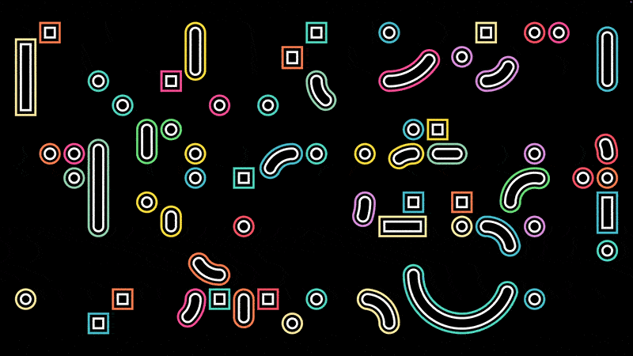
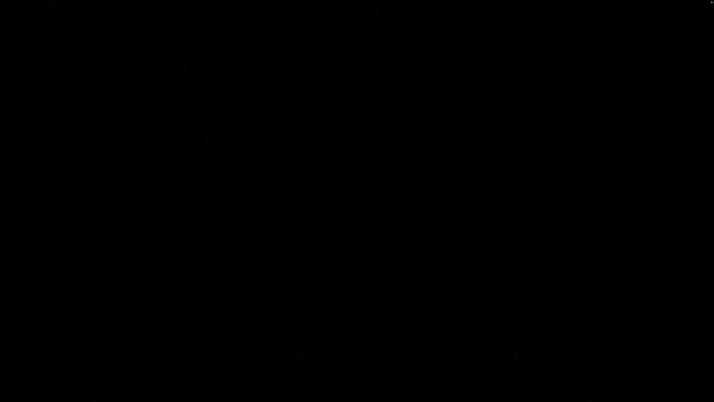

# amphore-saver

A macOS screensaver that mixes three generative animations — **Kinogrida**, **Shades** and **Psykala** — picking a random one per screen and switching with a fade. Each animation is also available as its own screensaver.

| Kinogrida | Shades |
|---|---|
|  |  |

## ⚠️ Epilepsy Warning

Shades can produce rapidly flashing and shifting patterns that may trigger seizures in photosensitive individuals. Viewer discretion is advised. Shades can be disabled in the amphore-saver options.

## Screensavers

| Saver | Description |
|---|---|
| **amphore-saver** | Random mix of the three scenes below. Each screen shows a different scene; all screens switch together after the configured duration, through a fade to black. |
| **Kinogrida** | Arcs and rounded squares moving across a grid, with periodic palette changes. Port of the [Kinogrida web project](https://github.com/Amphore-Dev/Kinogrida). |
| **Shades** | Grids of squares, circles, spirals, triangles or the current time, drawn many times with decreasing opacity. Port of the [Shades web project](https://github.com/Amphore-Dev/Shades). |
| **Psykala** | Geometric artworks from [psykala.com](https://psykala.com), cycling with fades. Falls back to bundled artworks when offline. |

## Installation

1. Download the `.saver.zip` you want from [Releases](https://github.com/Amphore-Dev/amphore-saver/releases) and unzip it
2. Double-click the `.saver` file — macOS installs it
3. Open **System Settings → Screen Saver** and select it

Requires macOS 11.5 or later (Apple silicon and Intel).

## Options

Click **Options…** in System Settings → Screen Saver.

- **General** — frame rate (60/30 fps). amphore-saver adds scene duration, transition fade and which scenes to include.
- **Kinogrida** — palette, palette change interval, cell size, grid fill, animation cycle, palette fade.
- **Shades** — shape types, clock format, start with clock, scene interval, max shades, drift amplitude, scene fade.
- **Psykala** — artwork duration, offline-only mode, artwork fade.

Each tab has a **Reset** button.

## Build from source

Requires Xcode 16+ and [XcodeGen](https://github.com/yonaskolb/XcodeGen) (`brew install xcodegen`).

```bash
make                       # generate the Xcode project and build all savers
make install               # build + install all savers to ~/Library/Screen Savers
make install SAVER=Shades  # install a single saver
make remove                # uninstall
make release               # sign (Developer ID), notarize and staple into dist/
```

If System Settings shows a generic blue thumbnail or an outdated version after reinstalling, run `make refresh-settings` and reopen System Settings: macOS caches screensaver thumbnails and never invalidates them.

`make release` needs a notarytool keychain profile, created once:

```bash
xcrun notarytool store-credentials amphore --apple-id <apple-id> --team-id JTV45F2TPG
```

The Xcode project is generated from `project.yml`: run `make project` and open `amphore-saver.xcodeproj`.

## Architecture

The animations live in a Swift package (`Package.swift`) so they can be reused by any host:

```
Sources/
├── ScreensaverCore/   ScreensaverScene protocol, declarative settings,
│                      options sheet, shared ScreenSaverView host
├── KinogridaKit/      KinogridaScene
├── ShadesKit/         ShadesScene (+ Remained font)
└── PsykalaKit/        PsykalaScene (+ bundled offline artworks)
Savers/
├── AmphoreSaver/      mixing host
├── Kinogrida/         single-scene wrappers (a few lines each)
├── Shades/
└── Psykala/
```

A scene implements `ScreensaverScene` (`start`, `update`, `draw`, `resize`) and exposes a `SceneDescriptor` (id, name, settings, factory). Adding a new animation means adding a Kit target, a descriptor, and listing it in `AmphoreSaverView.catalog`.

The Kinogrida, Shades and Psykala histories were imported with `git subtree`, so `git log --follow` works on the moved files.

## License

[MIT](LICENSE) © Amphore Dev
